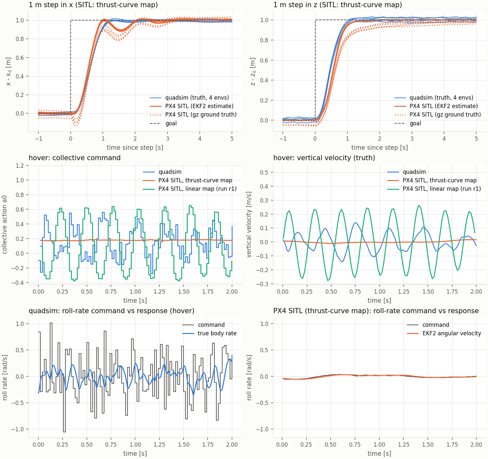

# Progress log (verified results only)

Legend: ✅ verified by an executed test (artifact linked) · 🟡 implemented, partially verified · ⬜ not started

> **Erratum (session 5 review).** Sections before "Review and corrections" record numbers as they were measured
> at the time. `scripts/rl/evaluate.py` then stopped at a global episode count, which over-weights short
> episodes; every evaluate.py result was re-measured with the corrected evaluator and the review fixes - the
> current values are in [Review and corrections](#review-and-corrections-2026-11-01-session-5), which supersedes the
> earlier tables where they differ.

## Milestone 1 — Isaac Sim / Isaac Lab foundation ✅ (2026-11-01)
- Stack: Isaac Sim 5.1.0 (pip) + Isaac Lab v2.3.2 + torch 2.7.0+cu128 on RTX 5060 8 GB (sm_120).
- `scripts/validation/m1_isaac_smoke_test.py`: headless boot 2.8 s; 64 rigid bodies free fall 0.5 s at dt=1/400:
  |z − z_symplectic| = 9.5e-7 m, |z − z_analytic| = 6.1e-3 m (= expected O(dt) bias g·t·dt/2). → `docs/results/m1_smoke_test.json`
- Finding: PhysX rigid bodies integrate with symplectic (semi-implicit) Euler.
- Finding: Isaac Lab stock `Isaac-Quadcopter-Direct-v0` cannot run here: its Crazyflie USD download from NVIDIA's CDN
  did not complete within 625 s (network). Hence all quadsim assets are procedural.

## Milestone 2 — Quadrotor dynamics ✅ (2026-11-01)
- Pure-PyTorch core (`quadsim.core`): presets X500 (PX4 SITL gz model) and Crazyflie 2.x (Förster 2015),
  exact first-order asymmetric motor model, thrust/yaw-moment, rotor drag + rolling moment, body drag,
  rotor gyroscopic & spin-up torques, ground effect, wind (mean + Gauss–Markov turbulence + 1-cos gusts),
  push disturbances, mixer with PX4-style desaturation, rate PID / attitude P / position-velocity cascade, Lee SE(3) controller,
  RK4 + semi-implicit reference integrators.
- Unit tests `tests/core` (27 tests, CPU, ~10 s): ✅ all pass. Include torque sign conventions, exact motor response,
  Euler-equation conservation (Dzhanibekov tumbling), first-order convergence of semi-implicit → RK4,
  closed-loop cascade step (<5 cm), Crazyflie recovery from 46° tilt + 3.7 rad/s spin, SE(3) circle tracking RMSE < 0.1 m.
- Isaac integration: procedural USD quadrotor (explicit MassAPI), body wrench written via `permanent_wrench_composer`
  each physics step (200 Hz), PhysX integrates rigid body + contacts.
- `scripts/validation/m2_dynamics_validation.py` (both presets ✅ all pass):

| Test | X500 | Crazyflie | criterion |
|---|---|---|---|
| T1 PhysX mass / inertia vs preset | 0 / 0 rel. err | 0 / 0 | < 1e-4 |
| T2 hover drift (2 s) | 0.0 mm | 0.0 mm | < 5 mm |
| T3 thrust step accel. RMS err / peak | 0.019 % | 0.026 % | < 2 % |
| T4 yaw accel. vs τ/I_zz | 0.004 % | 0.008 % | < 3 % |
| T5 open-loop 1.5 s pos. err vs semi-implicit ref. | 0.40 mm | 2.1 mm | < 1 cm |
| T5 att. err vs semi-implicit ref. | 0.006° | 0.066° | < 0.5° |
| T5 pos. err vs RK4 (integration error of PhysX @200 Hz) | 3.3 mm | 8.9 mm | (info) |
| T6 closed-loop velocity cascade PhysX vs ref. (3 s) | 12 mm | 9 mm | < 3 cm |

  Artifacts: `docs/results/m2_dynamics_{x500,crazyflie}.json`, `docs/figures/m2_dynamics_*.pdf`.

## Milestone 3 — Sensors, visualization, recording ✅ (2026-11-01)
- Sensor models (`quadsim.core.sensors`): IMU (white noise density, turn-on bias, Gauss–Markov bias drift,
  scale/misalignment, sample-and-hold rate, latency), barometer (ISA), magnetometer, GPS, odometry/state-estimate
  model (noise, VIO-like drift, delay; profiles perfect/mocap/vio/gps_ins), depth-camera noise (stereo σ∝z²,
  dropouts, quantization, range limits), RGB photometric augmentation, analytic ray casting (ground, cylinders,
  yaw-boxes) for range finders / LiDAR rings / synthetic depth, wind and push disturbances.
- Unit tests `tests/core/test_sensors.py` (13): ✅ IMU noise std at 200 Hz within 5 % of σ_c·√f, turn-on bias,
  exact latency (3 steps), free-fall specific force = 0, ISA (100 m → 100129 Pa), exact ray geometry,
  depth-noise statistics, wind turbulence σ. **Bug found by the recording plot and fixed:** no-return pixels were
  receiving σ∝z² noise (regression test added).
- Rendered depth (RTX TiledCamera) vs analytic ray-cast depth, `scripts/validation/m3_depth_consistency.py`
  (64 random poses, 96×72, HFOV 87°, noise off), ✅:
  | camera pitch | median abs err | p90 | hit/miss agreement | self-occluded px |
  |---|---|---|---|---|
  | 0° (default mount (0.15, 0, −0.06) m) | 7.2 mm | 2.4 cm | 99.6 % | 0 % |
  | +15° | 9.0 mm | 2.3 cm | 99.5 % | 5.6 % (front rotors) |
  Finding: the first camera mount (0.12, 0, 0.02) saw the X500 rotor discs (3 % of pixels); default moved.
- Tasks registered (all pass the smoke test, finite obs, consistent spaces; `docs/results/env_smoke_test.json`):
  Hover, Hover-Motor, Track, Waypoint, Nav-Range, Nav-Depth (ray-cast), Nav-Depth-Render, Nav-RGB, Nav-RGBD.
- Synchronized HDF5 recorder (`quadsim.data.recorder`) + `scripts/data/record.py`: round-trip verified
  (shapes, monotonic time, dt, last-sample equality, embedded config) for tracking (state) and rendered-depth nav
  (images as uint16 mm). Plotting: `scripts/data/plot_recording.py` → `docs/figures/m3_recording_*.png`.
- Visualization: procedural target/reference markers, chase camera, `scripts/tools/view.py` (GUI / MP4).
  ✅ Headless MP4 of trained hover and depth-navigation policies (`outputs/videos/`, frames in
  `docs/figures/video_*_frames.png`) and interactive GUI (full `isaaclab.python.kit`, 500 steps, no errors) after
  the upstream patch below, on an idle GPU.
- Known transient: the very first launch with `--enable_cameras` crashed once in `libslang.so` while compiling
  shaders (empty shader cache); every later launch succeeded.

## Milestone 4 — State-based RL ✅ (hover, tracking, waypoints; multi-seed hover in session 3)
- PPO (rsl_rl 3.1.2), asymmetric actor-critic: actor sees only deployable obs (noisy, delayed odometry + gyro +
  last action + task), critic additionally sees true state, rotor speeds, wind, disturbance, DR parameters.
  Control interface CTBR (collective thrust + body rates → onboard PX4-like rate PID at 200 Hz), policy 50 Hz.
  Training-time randomization: mass ±10 %, inertia ±15 %, CoM ±1 cm, k_f ±10 %/rotor, k_m ±15 %, motor τ ×[0.7,1.6],
  ω_max ×[0.92,1], drag ×[0.5,1.5], payload −5…+10 % weight, sensor-noise scale ×[0.5,1.5], action delay 0–2
  physics steps, odometry delay 0–2 steps.
- Hover: 4096 envs, 600 iterations (79 M steps), ~190 k steps/s alone on the RTX 5060, 3.9 GB VRAM.
  Evaluation (deterministic policy, 1000 episodes, same seeds for both controllers, `scripts/rl/evaluate.py`):

  | condition | controller | success¹ | crash | final pos. err | final yaw err |
  |---|---|---|---|---|---|
  | nominal (training dist.) | **PPO** | **99.9 ± 0.2 %** | 0.1 % | **1.38 ± 0.26 cm** | 4.4° |
  | nominal | cascade PID | 88.7 ± 2.0 % | 0.5 % | 6.1 ± 0.7 cm | 1.5° |
  | + wind 0–3 m/s, turbulence, gusts, pushes ≤0.3 mg (unseen) | **PPO** | **97.3 ± 1.0 %** | 0.1 % | 2.9 cm | 4.6° |
  | same | cascade PID | 78.6 ± 2.5 % | 0.7 % | 8.3 cm | 1.8° |

  ¹ success = |e_p| < 10 cm and |v| < 0.2 m/s at the end of the 8 s episode starting from up to 57° tilt, 1.5 m/s,
  3 rad/s and 1.5 m offset. ± = 95 % CI. Results: `docs/results/eval_hover_*.json`.
  Limitation: the PPO policy's final yaw error (4.4°) is worse than the baseline's (weak yaw reward).

- Tracking: 4096 envs, 1500 iterations (197 M steps). Evaluation, 500 episodes each, same seeds
  (`docs/results/eval_track_*.json`):

  | reference set | controller | RMSE | max err | crash |
  |---|---|---|---|---|
  | aggressive (≤4 m/s, accel. up to ~15 m/s²) | **PPO** | **12.6 ± 1.5 cm** | 40.6 cm | 0.2 % |
  | aggressive | cascade PID (vel+acc FF) | 46.6 ± 3.7 cm | 103 cm | 3.2 % |
  | aggressive | SE(3) geometric (v2) | 49.2 ± 3.9 cm | 98 cm | 1.8 % |
  | aggressive | SE(3) v1 (torque-level law mapped to rates at 50 Hz) | 114 cm | 222 cm | **53 %** |
  | moderate (≤2 m/s, ≤0.35 Hz) | **PPO** | **5.8 ± 0.2 cm** | 29 cm | 0 % |
  | moderate | cascade PID | 17.4 ± 1.3 cm | 50 cm | 0 % |
  | moderate | SE(3) geometric (v2) | 22.7 ± 1.4 cm | 53 cm | 0.2 % |

  The first SE(3) baseline was a design error (high-gain attitude law executed at the 50 Hz policy rate through
  the delay chain); it was replaced by Lee's position law + onboard attitude/rate loops. Baseline gains are
  defaults, not tuned. Part of the aggressive set exceeds the baselines' tilt limits (0.6–0.7 rad).
- Waypoint: 4096 envs, 1500 iterations. 500 episodes (`docs/results/eval_waypoint_nominal.json`):
  PPO **99.4 % success**, 5 waypoints in **6.6 s**, 0.6 % crash; cascade 92.8 %, 10.4 s, 2.2 % crash.
- DR ablation (hover; identical policy trained without DR/noise/latency; 1000 episodes per row;
  `docs/results/eval_dr_ablation_*.json`):

  | eval condition | with DR | without DR |
  |---|---|---|
  | ideal (no DR/noise/delay) | 100 %, 0.22 cm, yaw 3.7° | 100 %, 0.28 cm, yaw 9.8° |
  | training randomization | 99.9 %, 1.38 cm | 99.9 %, 2.05 cm |
  | harsh OOD (mass ×0.8–1.25, motor τ ×1.5–2.5, k_f ×0.8–1, noise ×1.5–2, 10–20 ms delay, wind) | 78.5 ± 2.5 %, crash 3.9 %, 16.4 cm | 77.2 ± 2.6 %, crash 4.9 %, 18.6 cm |

  Honest reading: DR lowers errors everywhere but the harsh-condition success difference is **not significant**;
  CTBR + onboard rate loop already absorbs much parameter variation. Single seed per arm.
- SAC (skrl 1.4.3, `scripts/rl/train_sac.py`), hover, 256 envs, 30 k vectorized steps (7.7 M transitions, 21 min):
  pipeline ✅ executes and learns (episode return −11.2 → +1.7, still rising), but the policy is **not competitive**:
  0 % crash, 0 % success, 1.13 m final error (PPO reaches return ≈ 11). Under-trained (UTD ratio 1/256), untuned.

## Milestone 5 — Vision / navigation RL ✅ (criteria met; moderate depth-policy performance)
Full-density evaluation (curriculum off, 4–24 obstacles, mean ≈ 12; 500 episodes unless noted;
`docs/results/eval_nav_*.json`):

| policy input | controller | success | collision | time to goal |
|---|---|---|---|---|
| range ring (360°, 32 rays) | potential field (paired run / independent run) | 49.8 % / 39.3 % | 5.2 % / 4.4 % | 10.2 s |
| range ring | PPO, reward v1 (prox. 0.2, crash 10, γ 0.99) | 52.9 % | 46.3 % | 3.7 s |
| range ring | **PPO, reward v2** (prox. 2.0, crash 20, γ 0.995) | **83.0 ± 3.3 %** | 16.6 % | 4.2 s |
| depth 64×48, analytic (training sensor) | PPO v2, CNN, 900 it. | 61.1 ± 4.3 % | 36.9 % | 4.3 s |
| depth, **zero-shot on RTX-rendered depth** (300 ep.) | same policy | 66.7 ± 5.3 % | 32.7 % | 4.2 s |

- Reward v1 → v2 is a documented reward iteration (v1 policy flew at the speed limit and accepted collisions).
- The potential field rarely collides but is trapped in local minima (42–52 % time-outs). Its two runs differ by more
  than the per-run CI: layouts are not paired across runs (shared RNG stream consumed differently).
- Depth policy: analytic → rendered depth shows no degradation (within CI) — supports training on the 12× faster
  analytic sensor. Its gap to the 360° range policy is plausibly the 87° field of view without memory (unverified).
- Depth run stopped at iteration 900 of 1500 (curriculum reached 24 obstacles at it. 501; success flat over the
  last 300 it.) for time reasons; more training may help.
- RGB-D: rendered RGB + depth → CNN PPO executes end to end (10-iteration run, 64 envs). No performance claim.

## Milestone 6 — Sim-to-Real interfaces ✅ (bridge flown in PX4 SITL; all tasks deployable)
- Export (`scripts/rl/export.py`): TorchScript + ONNX with normalizer and clamp; ONNX vs PyTorch max |Δ| = 3.6e-7 ✅.
  Machine-readable interface contract (`contract.json`, example `docs/results/contract_hover.json`).
- `quadsim.deploy.interface` (NumPy only): ENU/FLU ↔ NED/FRD, PX4 odometry → sim conventions, observation
  builder, action decoder → PX4 `VehicleRatesSetpoint` / `TrajectorySetpoint`. 7 unit tests ✅ (incl. frame
  consistency of a physical body vector through both quaternion conventions).
- Deployment pipeline in the loop (`scripts/validation/m6_deploy_consistency.py`, hover, 512 episodes) ✅:
  ONNX policy fed by the NumPy builder flies the simulator; max obs error 9.5e-7, max action error 1.0e-6,
  success 99.8 % (identical to PyTorch).
- ROS 2 package `ros2/quadsim_px4_bridge` (offboard node, launch, config): ✅ flown against PX4 v1.16.2 SITL with the
  hover policy after fixing four bugs (see "PX4 SITL cross-check" below); not flown on hardware.

## Milestone 7 — Docker, benchmark, documentation ✅
- `docker/Dockerfile` on the official `nvcr.io/nvidia/isaac-lab:2.3.2`; compose services test/train/gui/tensorboard.
- NGC refuses direct connections from this network (HTTP 403); the Docker daemon ignores the shell proxy.
  `scripts/tools/pull_image_via_proxy.py` pulls via the registry API through the user's proxy with sha256
  verification and `docker load`s the image (8.41 GB compressed).
- `docker compose run --rm test` ✅: unit tests and the Isaac Sim GPU smoke test pass inside the container.
- Benchmark (idle GPU, env stepping only; `docs/results/benchmark.jsonl`): Hover 16 k / 63 k / 237 k / 439 k env-steps/s
  at 256 / 1024 / 4096 / 8192 envs (3.9 GB at 8192); Nav-Depth (analytic) 83 k @ 2048 (4.4 GB); RTX-rendered depth
  6.8 k @ 256 (5.6 GB); RGB-D 3.8 k @ 128.
- M2 regression re-run with the upstream patch active: all pass.
- README, `docs/SIM2REAL.md`, LaTeX report `report/report.pdf` (14 pages; tables generated from `docs/results`).

## PX4 SITL cross-check (roadmap "PX4 SITL/HITL loop") ✅ hover policy (2026-11-01)
**Result: the exported hover policy flies PX4 v1.16.2 SITL (Gazebo `x500`) as an offboard controller through
`ros2/quadsim_px4_bridge`.** All 10 full-schedule runs with the fixed bridge (60 s in OFFBOARD: hold, 1 m x step,
1 m z step) completed without leaving OFFBOARD or triggering a failsafe, followed by a normal hand-back and landing.
PX4 received 3004–3006 rate set-points per 60 s (max gap 21 ms, none > 30 ms). The original bridge did **not** fly
(bugs below). Recommended configuration: thrust-curve map (finding 2).

Setup (reproducible: `ros2/px4_sitl/setup_px4_sitl.sh`, `scripts/sitl/run_sitl.sh`; native on the host, no Docker):
PX4 v1.16.2 SITL, airframe 4001 `gz_x500`, Gazebo Harmonic 8.14 (headless, lockstep, real-time factor 1.000),
Micro-XRCE-DDS Agent (UDP), ROS 2 Jazzy (the host's install; the bridge only uses rclpy APIs that also exist in Humble),
`px4_msgs` generated from the same PX4 tree. PX4 parameters: airframe defaults + `NAV_DLL_ACT=0` (no GCS).
SITL-only instrumentation: gz ground-truth topics exported over uXRCE-DDS (evaluation only). Policy
`quadsim_hover/2026-11-01_02-30-46_ctbr_s42` (model_599, ONNX), 50 Hz, CTBR → `VehicleRatesSetpoint`.
Scenario (`scripts/sitl/sitl_scenario.py`): PX4 take-off to 2.5 m → PX4 Hold → `thrust_scale` from PX4's hover-thrust
estimate → goal := current pose → OFFBOARD (policy) → 30 s hold → goal +1 m x (15 s) → +1 m z (15 s) → PX4 Hold →
land. quadsim counterpart (`scripts/sitl/quadsim_scenario.py`, 64 envs, seed 7): same schedule, every env starts at
the goal at rest (= hand-over). Both are evaluated by the same code (`quadsim.deploy.closed_loop_metrics`, unit-tested):
"truth" = simulator ground truth, "estimate" = what the policy sees (quadsim odometry model / PX4 EKF2).
Comparison: `scripts/sitl/compare.py` → `docs/results/sitl_comparison.json` (per-run values),
figure `scripts/sitl/plot_comparison.py`. Raw runs (`.npz`, bridge step logs, PX4 `.ulg`) in `logs/sitl/` (git-ignored).

| metric | quadsim: nominal (n=64 envs) | quadsim: training DR (n=64 envs) | PX4 SITL, linear thrust map (n=3 runs) | PX4 SITL, thrust-curve map (n=4 runs) | PX4 SITL, linear + CA_ROTOR fix (n=2 runs) | PX4 SITL, uncalibrated (scale 1.0) (n=1 runs) |
|---|---|---|---|---|---|---|
| hover RMS 3-D error, ground truth [cm] | 1.59 ± 0.46 | 1.76 ± 0.62 | 4.12 ± 1.9 | 6 ± 1.1 | 4.71 ± 1.1 | 7.74 |
| hover RMS horizontal / vertical, ground truth [cm] | 1.27 ± 0.44 / 0.868 ± 0.4 | 1.32 ± 0.52 / 1.05 ± 0.59 | 2.95 ± 1.1 / 2.83 ± 1.6 | 3.97 ± 0.73 / 4.32 ± 1.5 | 3.95 ± 1 / 2.55 ± 0.38 | 2.46 / 7.34 |
| hover RMS 3-D error w.r.t. onboard estimate [cm] | 1.88 ± 0.021 | 2.05 ± 0.49 | 1.02 ± 0.13 | 0.828 ± 0.04 | 1.01 ± 0.22 | 1.55 |
| estimate vs ground truth position RMS (hover) [cm] | 2.28 ± 0.31 | 2.42 ± 0.58 | 3.84 ± 2.1 | 5.81 ± 1.2 | 4.51 ± 1.1 | 6.38 |
| x step (truth): rise time 10-90 % [s] | 0.652 ± 0.011 | 0.647 ± 0.016 | 0.553 ± 0.025 | 1.03 ± 0.46 | 1.01 ± 0.45 | 0.6 |
| x step (truth): overshoot [%] | 1.34 ± 1.2 | 1.55 ± 1.3 | 3.47 ± 0.67 | 2.49 ± 2.5 | 2.99 ± 2.4 | 4.62 |
| x step (truth): settling time (5 cm) [s] | 1.05 ± 0.029 | 1.05 ± 0.04 | 1.87 ± 0.081 | 7.28 ± 5.1 | 10.7 ± 3.7 | 1.87 |
| z step (truth): rise time 10-90 % [s] | 0.633 ± 0.011 | 0.689 ± 0.054 | 0.92 ± 0.099 | 1.06 ± 0.13 | 0.83 ± 0.01 | 2.04 |
| z step (truth): overshoot [%] | 1.6 ± 1.2 | 1.25 ± 1.3 | 2.31 ± 1.8 | 0 | 3.6 ± 0.72 | 0 |
| z step (truth): settling time (5 cm) [s] | 0.962 ± 0.036 | 1.2 ± 1 | 1.52 ± 0.16 | 4.13 ± 2.6 | 1.44 ± 0.071 | nan |
| x step w.r.t. estimate: rise [s] / overshoot [%] / settling [s] | 0.646 ± 0.014 / 3.86 ± 0.39 / 1.07 ± 0.022 | 0.643 ± 0.022 / 3.9 ± 1.1 / 2.86 ± 3.8 | 0.536 ± 0.0065 / 1.89 ± 0.22 / 1.84 ± 0.019 | 0.55 ± 0.01 / 1.49 ± 0.1 / 1.86 ± 0.02 | 0.54 ± 0.004 / 1.68 ± 0.03 / 1.86 ± 0.023 | 0.584 / 2.69 / 1.89 |
| z step w.r.t. estimate: rise [s] / overshoot [%] / settling [s] | 0.625 ± 0.015 / 4.1 ± 0.29 / 0.998 ± 0.028 | 0.685 ± 0.056 / 3.86 ± 1 / 4.09 ± 5 | 0.643 ± 0.014 / 1.34 ± 0.49 / 1.07 ± 0.047 | 0.636 ± 0.012 / 0.44 ± 0.017 / 1.02 ± 0.017 | 0.624 ± 0.024 / 1.03 ± 0.65 / 1.07 ± 0.027 | 0.744 / 0 / 1.24 |
| rate cmd -> true rate: delay (roll / pitch) [ms] | 13.2 ± 4.3 / 13.2 ± 4.3 | 16.2 ± 6.3 / 15.6 ± 5.3 | 22.7 ± 0.94 / 12.7 ± 1.9 | 31 ± 1 / 10 ± 1.4 | 15 ± 5 / 10 ± 2 | 28 / 8 |
| rate cmd -> true rate: time constant (roll / pitch) [ms] | 53.1 ± 1.9 / 52 ± 6.9e-15 | 45.5 ± 11 / 48.8 ± 9.7 | 46.9 ± 1.7 / 39.1 ± 1.5 | 38 / 42 ± 1.4 | 38.2 ± 3 / 41.3 ± 3.2 | 44.5 / 38 |
| rate cmd -> true rate: gain (roll / pitch) | 1.02 ± 0.021 / 1.01 ± 0.0066 | 0.841 ± 0.19 / 0.907 ± 0.16 | 0.995 ± 0.007 / 0.968 ± 0.0093 | 0.959 ± 0.0065 / 1.02 ± 0.018 | 1.04 ± 0.024 / 0.993 ± 0.027 | 0.945 / 0.981 |
| rate cmd -> true rate: VAF (roll / pitch) | 0.972 ± 0.0062 / 0.986 ± 0.0017 | 0.838 ± 0.14 / 0.906 ± 0.12 | 0.955 ± 0.0014 / 0.97 ± 0.0067 | 0.959 ± 0.00051 / 0.985 ± 0.002 | 0.97 ± 0.0094 / 0.974 ± 0.0098 | 0.94 / 0.984 |
| hover collective action a0: std / dominant frequency [Hz] | 0.174 ± 0.018 / 3.56 ± 0.42 | 0.176 ± 0.038 / 3.45 ± 0.55 | 0.218 ± 0.14 / 4 ± 0.2 | 0.00465 ± 0.00016 / 0.813 ± 0.27 | 0.178 ± 0.17 / 2.25 ± 1.5 | 0.0222 / 7.5 |
| hover vertical velocity RMS, truth [cm/s] | 5.39 ± 1.1 | 5.41 ± 1.4 | 10.1 ± 6.2 | 1.02 ± 0.036 | 8.79 ± 7.8 | 1 |
| hover body-rate RMS, truth (roll / pitch) [rad/s] | 0.172 ± 0.013 / 0.175 ± 0.017 | 0.186 ± 0.047 / 0.189 ± 0.046 | 0.0731 ± 0.034 / 0.0782 ± 0.043 | 0.0259 ± 0.0022 / 0.0184 ± 0.0021 | 0.0589 ± 0.034 / 0.0789 ± 0.06 | 0.0272 / 0.257 |
| hover body-rate dominant frequency (roll / pitch) [Hz] | 3.11 ± 1.9 / 5.05 ± 1.4 | 3.07 ± 1.9 / 4.79 ± 1.5 | 2.92 ± 1.4 / 2.92 ± 1.4 | 0.813 ± 0.11 / 0.75 | 2.25 ± 1.5 / 2.25 ± 1.5 | 0.75 / 7.5 |
| estimate attitude lag vs truth (roll / pitch) [ms] | 4.8 ± 4 / 4.7 ± 4 | 6.05 ± 4 / 6 ± 4.1 | 3 / 2 | 3.25 ± 0.43 / 2 | 3 / 2 | 4 / 2 |
| odometry age at policy step: median / p95 [ms] | – | – | 11.9 ± 0.94 / 15.9 ± 1 | 7.99 ± 1.8 / 12 ± 1.7 | 12.5 ± 3.2 / 16.6 ± 3.2 | 13.8 / 17.9 |

± = std over runs (SITL) or over the 64 envs (quadsim). All SITL runs of this table used PX4's default
`EKF2_GPS_DELAY` = 110 ms (see session 3: the x-step settling and truth-referenced errors in motion are affected, the
stationary hover numbers are not). Hover window 10–30 s after the hand-over. "w.r.t. estimate"
rows measure what the policy regulates (control performance); "truth" rows include the estimator's error. Rate
response: output-error fit of `rate(s)/cmd(s) = K e^{-Ls}/(τs+1)` over the whole flight (closed-loop data; VAF =
variance accounted for); SITL truth rate = gz ground truth at 50 Hz. Columns: linear map = `thrust_scale` only
(SIM2REAL §3, the documented procedure); thrust-curve map = exact inverse of the gz motor curve (finding 2);
CA_ROTOR fix = linear map + PX4 allocation geometry set to the gz rotor positions (finding 4).

Findings
1. **Control performance transfers; the estimator does not match the training model.** Referenced to the estimate
   the policy regulates, SITL (thrust-curve map) matches or beats quadsim: hover RMS 0.83 cm (quadsim 1.9 cm), z step
   rise 0.64 s / settling 1.02 s (0.63 s / 1.00 s), x step rise 0.55 s (0.65 s). Referenced to ground truth SITL is
   worse (hover 4–6 cm vs 1.6 cm) because EKF2 (GNSS + baro, gz sensor noise) has a slowly varying position error of
   2.3–7.7 cm RMS per run (bias up to 6 cm in z), whereas quadsim's odometry model is white-noise dominated (2.3 cm).
   Truth-referenced step metrics in SITL therefore mostly measure EKF2 drift (e.g. x settling 7–11 s w.r.t. truth vs
   1.86 s w.r.t. the estimate). The smooth EKF2 estimate also makes the policy's commands much quieter than in quadsim
   (figure, rows 2–3), which is why the control error is smaller in SITL.
2. **Heave limit cycle with the linear thrust map; removed by the thrust-curve map.** With `thrust_scale` only, 3 of 5
   calibrated runs (default_r1/r3, geom_r1) showed a persistent 3.75–4 Hz vertical oscillation from the hand-over to the
   end: collective action std 0.30–0.36 (swinging −0.4…+0.7), vertical velocity 0.14–0.17 m/s RMS (truth and EKF2),
   coupled roll/pitch-rate oscillation 0.09–0.15 rad/s at ~5 Hz; position RMS w.r.t. the estimate stayed ≈ 1 cm. The
   other 2 runs were quiet (a0 std ≤ 0.023, 0.010–0.014 m/s). Cause (supported, not proven): the linear map is exact
   only at hover; around hover the gz motor curve (`T = T_max (0.15 + 0.85 u)^2`) has 1.6× the thrust gain the policy
   was trained with, so the vertical loop's lightly damped ~3.5–4 Hz mode, which is also visible in quadsim as
   noise-driven heave (vertical velocity 5.4 cm/s RMS, collective chatter at 3.6 Hz), becomes a limit cycle. With the
   exact inverse of the curve (`ThrustCurve`, bridge parameter `thrust_curve`) **0 of 4 runs** oscillated (a0 std
   0.004–0.005, vertical velocity 1.0 cm/s, body rates ≤ 0.03 rad/s). 0/4 vs 3/5 is suggestive but small
   (Fisher one-sided p ≈ 0.12); what selects the quiet or the oscillating regime under the linear map is not identified
   (not odometry age). For hardware: identify the thrust curve (thrust stand) and use the curve map; consider
   randomizing the thrust-curve shape in training.
3. **Thrust calibration.** PX4's hover-thrust estimate is 0.7295 ± 0.0001 over 10 runs (analytic value for the gz
   motor model 0.729), while the x500 default `MPC_THR_HOVER` is 0.60 → linear `thrust_scale` = 0.7295 / 0.592 = 1.232
   (`MPC_THR_HOVER` would give 1.01). With the curve map the calibrated scale is 1.0016, i.e. the gz x500 and the
   quadsim preset agree on hover thrust within 0.2 %. The linear map also saturates (u = 1) once the policy asks for
   more than 81 % of T_max (unit test). With `thrust_scale = 1.0` (−19 % thrust at the hover command, outside the
   training randomization) the policy still flies: it raises its collective (a0 0.43) and holds −1.3 cm below the goal
   w.r.t. the estimate; z step rise 0.74 s; this run showed a 7.5–9.5 Hz pitch-rate oscillation (0.29 rad/s RMS, not
   investigated).
4. **Rate loop: pitch as fast as quadsim's, roll slower because of the allocation geometry.** Command → body-rate fits
   (truth body rates from central differences of the ground-truth attitude; an earlier version of this analysis used
   PX4's backward-differenced Euler-angle "ground-truth angular velocity" and overstated all SITL delays by ~10 ms —
   corrected): pitch delay 8–14 ms, τ 38–44 ms in SITL vs 13 ms / 53 ms in quadsim (13 ms = 0–10 ms action delay +
   motor lag + PID), i.e. PX4's pitch loop is slightly *faster*. Roll is slower (22–32 ms delay with the default
   geometry) because PX4's x500 airframe `CA_ROTOR*` = (0.13, 0.20–0.22) m differ from the gz rotor positions
   (±0.174, ±0.174) m, so the allocator under-actuates roll. **Verified:** with `CA_ROTOR*` = gz geometry, roll delay
   20 ms (quiet run) / 10 ms (oscillating run) vs 24–32 / 22 ms with the default geometry under the same conditions;
   pitch unchanged. Fitted delays depend on the excitation (closed-loop identification, read as ±10 ms).
5. **x step settled slower in these runs** (1.86 ± 0.02 s vs 1.07 s w.r.t. the estimate): after a faster rise the
   position dipped back to ≈ 0.9 m at ≈ 1.5 s. **Resolved in session 3:** the cause was the SITL GNSS-delay
   mis-configuration (`EKF2_GPS_DELAY` 110 ms vs a latency-free gz GNSS, estimate leading the truth by 0.11 s in motion);
   the same policy with `EKF2_GPS_DELAY=0` settles in 1.01–1.04 s (quadsim 1.07 s). All runs of this section used the
   110 ms default; their stationary hover numbers are unaffected.
6. **Hover collective and command chatter in quadsim.** In nominal quadsim the policy hovers with mean a0 ≈ 0.150
   instead of the static hover action 0.184 (−2.9 % commanded thrust). Replaying its command sequence through the x500
   motor model offline shows that the asymmetric motor lag (τ_up 12.5 ms < τ_down 25 ms) rectifies the chattering
   command (a0 std 0.17) into +2.2 % mean thrust (symmetric lag: −0.1 %), i.e. most of the gap. In SITL with quiet
   commands the policy hovers at a0 = 0.179–0.182 ≈ the hover action; the oscillating runs at 0.11–0.12.
7. **Latency.** Odometry (EKF2 `VehicleOdometry`, 100 Hz) is 3.8–8.0 ms old on arrival at the bridge (median per run;
   p95 8–12 ms) and 5–16 ms old at the policy step (median per run; p95 9–20 ms, max 23 ms) because the 50 Hz policy
   timer is not synchronized with the odometry stream — at and above the upper end of the trained 0–10 ms odometry
   delay. EKF2's attitude output lags the gz truth by only 2–4 ms (quadsim: 4.8 ms mean, 0–10 ms by construction).
   Policy period 20.0 ms (p99 ≤ 20.4 ms, max 21 ms).

Bridge bugs found and fixed (each reproduced first)
- **Versioned topics:** PX4 v1.16 publishes `VehicleStatus` (message version 1) on `/fmu/out/vehicle_status_v1`; the node
  subscribed to `/fmu/out/vehicle_status`, never saw OFFBOARD and never published a set-point. Reproduced with the
  original node (`logs/sitl/orignode_r1`): PX4 accepted OFFBOARD and stayed in it for 8 s while the node sent **0**
  rate set-points; the vehicle flew open-loop on the last attitude-controller set-point (3.5 m drift, up to 1.2 m/s)
  and no failsafe triggered. Fix: topic names derived from `px4_msgs` `MESSAGE_VERSION` (`px4_topic`).
- **Heartbeat not gated (safety):** the `OffboardControlMode` heartbeat was published before the stale-odometry and
  geofence checks, but PX4 detects offboard loss from that heartbeat alone (`offboardCheck.cpp`), so the documented
  "stop publishing → PX4 failsafe" could never happen (the original-node run above is this failure mode). Fix:
  heartbeat only while the node can command. Verified (`logs/sitl/fence_r1`): goal moved 4 m away (fence 3 m) → PX4
  flagged the failsafe and left OFFBOARD after 1.03 s (`COM_OF_LOSS_T` = 1 s) and, without RC, landed at 0.7 m/s.
- **Packaging:** missing `setup.cfg` → `ros2 launch/run` could not find `policy_node`.
- `last_action` input contained policy outputs computed (but never applied) while PX4 was flying → held at the hover
  action until the hand-over; odometry with NaN fields or an unsupported pose/velocity frame is rejected; body-FRD
  velocity is rotated to NED.
- New: thrust-curve map (`thrust_curve`), runtime goal / thrust changes via ROS parameters, optional per-step CSV log,
  launch arguments. The per-step logic lives in the ROS-free `quadsim.deploy.offboard.OffboardPolicy`; tests in
  `tests/core/test_offboard.py`, `test_deploy_interface.py`, `test_closed_loop_metrics.py` (64 core tests pass).
  A column-order bug in the new step log (q/velocity swapped vs the header) was found during the analysis and fixed;
  the analysis did not use the affected columns and the existing logs were rewritten in the corrected order.

Tooling findings: ROS 2's vendored `gz` on `PATH` cannot start PX4's Gazebo world (PX4 is run with `/opt/ros` removed
from `PATH`); a `gz sim` server surviving a run is silently re-used by the next PX4 instance with the old (crashed)
vehicle → processes are killed by process group and `run_sitl.sh` refuses to start next to a running instance; rclpy's
`MultiThreadedExecutor` dropped ~35 % of 300 msg/s in the recorder (PX4 itself received every set-point) →
`SingleThreadedExecutor`; `ls | head` under `set -o pipefail` aborted the log copy (SIGPIPE) in some runs.

Caveats: SITL only; one policy (hover, one seed); gz uses the same motor/drag parameters as the quadsim preset, so SITL
cross-checks the rigid-body engine, PX4's control/estimation stack and the interface — not the motor model; 3 + 4 + 2 + 1
SITL runs, so run-to-run statistics are coarse; rate fits use closed-loop data (VAF 0.92–0.98) and 50 Hz ground truth;
tracking / waypoint / velocity-interface policies not yet run in SITL.

## Continuation: audit, all tasks in PX4 SITL, sim-to-real v1 distribution (2026-11-01, session 3)
Goal: re-verify the reported results, take tracking / waypoint / navigation policies through PX4 SITL, and turn the
sim-to-sim gaps found in SITL into improvements of the training environment. Worktree branch
`claude/frosty-swartz-ab3133`; runs and logs in the main checkout's `logs/` (worktree `logs/*` are symlinks).

### Re-verification of reported results ✅
| item | reported | re-run (this session) | verdict |
|---|---|---|---|
| unit tests | 48 (README) / 60 | 78 pass (new tests added) | ✅ |
| env smoke test (6 non-camera tasks) | pass | pass | ✅ |
| M2 dynamics (x500) | all pass | all pass | ✅ |
| M6 deploy consistency (hover) | obs 9.5e-7, success 99.8 % | identical | ✅ |
| hover eval, 1000 ep. (PPO / cascade) | 99.9 % 1.38 cm / 88.7 % 6.1 cm | **bit-identical** at full precision, also with the final code of this session | ✅ |
| tracking eval, 500 ep. | 12.6 ± 1.5 cm | 12.2 cm | ✅ within CI (original used 250 envs, re-run 500 → other samples; `evaluate.py` now records `num_envs`) |
| waypoint eval, 500 ep. | 99.4 ± 0.7 % | 98.8 % | ✅ within CI (same reason) |
| camera tasks (rendered depth, RGB, RGB-D), 16 envs | pass | finite obs, image shapes 1/3/4×48×64 | ✅ |
| HDF5 recording round trip (tracking, geometric controller) | pass | pass | ✅ |
| rendered vs analytic depth (pitch 0°) | 7.2 mm median | 6.6 mm median, pass | ✅ |
| checkpoint resume (`train.py --resume`) | — | continues at the saved iteration (2 → 5) | ✅ |

### Deployment of all tasks ✅
- Tracking, waypoint and range-navigation policies exported (contract now has `task_params`: horizon, reach radius,
  ring geometry). `quadsim.deploy.offboard.OffboardPolicy` gained task objects (onboard sum-of-sines reference with
  task time from the hand-over, training waypoint switching, LaserScan → 32-ray ring with stale-sensor gating).
- Deploy-in-the-loop (`scripts/validation/m6_deploy_consistency.py`, generalized; ONNX + NumPy observation rebuilt from
  onboard quantities flies the simulator): hover / tracking / waypoint / nav-range max obs error 9.5e-7 / 7.5e-6 /
  2.9e-6 / 1.2e-6, max action error ≤ 8.4e-6; success / crash vs PyTorch within 3 points (nav: 80.8 vs 83.3 %) — all pass.

### SITL findings (methodology, estimator)
- **EKF2 GNSS delay mis-configuration in SITL.** EKF2's position led the gz truth by 0.11 s in motion: `EKF2_GPS_DELAY`
  defaults to 110 ms (right for real receivers) but gz's GNSS has no latency. With 0 ms: lead −3 ms, truth-referenced
  tracking error 14 → 7 cm (estimate-referenced unchanged). `run_sitl.sh` now sets it (`SITL_GPS_DELAY_MS`); hover runs
  of the first SITL section were stationary and unaffected.
- **Ground-truth artefacts of PX4's gz bridge**: ground-truth velocity and "angular velocity" are backward differences
  (the latter of Euler angles) → truth body rates are recomputed by central differences of the ground-truth quaternions
  (`body_rates_from_quat`); rate-loop fits in `docs/results/sitl_comparison.json` were recomputed.
- **EKF2 error statistics** (`scripts/sitl/estimator_stats.py` → `docs/results/sitl_estimator.json`, 6 hover runs):
  per-flight bias ~1.8 / 1.8 / 3.9 cm (x/y/z), slow error std 1.4 cm with 2–3 s correlation, fast error 1.3 mm,
  velocity error ~1 cm/s (0.3–2 s correlation), roll/pitch 0.2 mrad — quadsim's v0 model is mostly white
  (1 cm, 3 cm/s, 10 mrad). These define the v1 estimator model.

### Tracking, waypoints and navigation in PX4 SITL
Same reference / course / layouts in both simulators (`scripts/sitl/quadsim_task_scenario.py`, `sitl_scenario.py
--task`), thrust-curve map, `EKF2_GPS_DELAY=0`, scored by `scripts/sitl/compare_tasks.py` → `docs/results/sitl_tasks.json`.

**Tracking — circle (r 1 m, 0.2 Hz)** (SITL n=2 runs, quadsim n=32 envs; RMSE after 2 s)

| metric | quadsim | PX4 SITL |
|---|---|---|
| RMSE truth [cm] | 1.78 ± 0.37 | 6.34 ± 0.74 |
| RMSE horizontal, truth [cm] | 1.38 ± 0.33 | 5.12 ± 1.1 |
| RMSE vertical, truth [cm] | 1.07 ± 0.37 | 3.65 ± 0.25 |
| max error, truth [cm] | 3.33 ± 0.57 | 10.7 ± 0.15 |
| RMSE w.r.t. estimate [cm] | 2.47 ± 0.059 | 2.22 ± 0.24 |

**Tracking — figure-8 (r 1.5 m, 0.15 Hz)** (SITL n=2 runs, quadsim n=32 envs; RMSE after 2 s)

| metric | quadsim | PX4 SITL |
|---|---|---|
| RMSE truth [cm] | 2.67 ± 0.23 | 9.2 ± 0.4 |
| RMSE horizontal, truth [cm] | 2.34 ± 0.19 | 8.81 ± 0.15 |
| RMSE vertical, truth [cm] | 1.24 ± 0.32 | 2.51 ± 0.94 |
| max error, truth [cm] | 5.46 ± 0.65 | 16.8 ± 0.82 |
| RMSE w.r.t. estimate [cm] | 3.04 ± 0.054 | 3.42 ± 0.37 |

**Waypoints** (5-waypoint course; SITL n=2 runs, quadsim n=32 envs)

| metric | quadsim | PX4 SITL |
|---|---|---|
| course completed (policy's own logic) | 1 | 1 |
| time to finish [s] | 5.13 ± 0.017 | 6.74 ± 0.27 |
| waypoints passed within 0.3 m on truth (of 5) | 5 | 4 ± 1 |
| estimate error during the course, RMS / max [cm] | – | 15.2 ± 0.68 / 31.3 ± 0.31 |

**Navigation (range ring, velocity interface)** — per layout: quadsim success / collision rate over its envs vs the PX4 SITL outcome (time to goal [s])

| layout | obstacles | quadsim | PX4 default velocity loop | PX4 velocity loop matched to quadsim |
|---|---|---|---|---|
| 0 | 7 | 1.00 / 0.00 (4.05) | goal (4.25), min clearance 0.37 m | goal (4.02), min clearance 0.46 m |
| 1 | 15 | 0.38 / 0.62 (4.71) | collision, min clearance 0.14 m | collision, min clearance 0.12 m |
| 2 | 13 | 0.97 / 0.03 (4.23) | goal (4.38), min clearance 0.45 m | goal (4.21), min clearance 0.53 m |
| 3 | 15 | 0.97 / 0.03 (4.34) | collision, min clearance 0.25 m | goal (4.49), min clearance 0.49 m |
| 4 | 11 | 0.91 / 0.06 (4.33) | collision, min clearance 0.28 m | collision, min clearance 0.31 m |
| 5 | 15 | 1.00 / 0.00 (4.28) | collision, min clearance 0.23 m | goal (4.46), min clearance 0.53 m |
| all | | 0.87 / 0.12 | 0.33 success | 0.67 success |

- **Tracking transfers at the control level** (estimate-referenced RMSE equal within noise); truth-referenced error is
  3–4× larger in SITL because of EKF2's correlated error.
- **Waypoints**: course completed in every SITL run (also 1 extra geometry-fix run), but 6.3–7.0 s instead of 5.13 s.
  Ruled out: body drag (quadsim without body drag: 5.13 s), allocation geometry (6.29 s). At up to 7 m/s EKF2's error
  reaches 30 cm, so on truth some waypoints are passed just outside the 0.3 m radius. PX4 roll/pitch air mode
  (`MC_AIRMODE=1`, keeps attitude authority at saturated thrust): 6.45 / 6.20 s — within the spread, no clear change.
  Cause still open (remaining candidates: EKF2's error at 7 m/s affecting the estimate-based switching and the
  approach geometry, differences in motor saturation at full thrust).
- **Navigation (velocity interface) — largest gap.** With PX4's default velocity controller 2/6 layouts reached the goal
  (quadsim 87 %). Velocity-loop identification (FOPDT, lateral axis): PX4 default L = 0.21 s, τ = 0.52 s; quadsim cascade
  L = 0.14 s, τ = 0.22 s (`MPC_XY_VEL_P_ACC` 1.8 vs simulated 3.0). PX4 configured like the simulated cascade
  (`MPC_XY_VEL_P_ACC=3.0, MPC_XY_VEL_D_ACC=0, MPC_Z_VEL_I_ACC=1.0, MPC_TILTMAX_AIR=34.4`): τ = 0.25 s, **4/6 goals**;
  residual delay 0.21 vs 0.14 s (PX4 attitude/rate chain). One flight per layout → indicative only. Obstacles are virtual
  in SITL (`scripts/sitl/virtual_scan.py`, ring identical to the training caster, unit-tested; collisions from ground
  truth with the training radius); no contact physics.

### Sim-to-real training distribution v1 and multi-seed hover
`Quadsim-{Hover,Track,Waypoint}-v1` (`quadsim.tasks.apply_sim2real_v1`): EKF-like estimate errors (per-flight bias,
Gauss–Markov position/velocity errors; levels from SITL EKF2, widened), action and estimator delay 0–20 ms, noise scale
×[0.5, 2], rate-PID gain ×[0.6, 1.4], thrust-map gain around hover ×[0.8, 1.7]. All new terms are off in the v0 tasks
(v0 evaluations bit-identical, unit test for the unchanged random stream).

Hover, 3 seeds per training distribution (v0: seed 42 + seeds 1, 2), same evaluation for all
(`scripts/sitl/hover_v1_summary.py` → `docs/results/hover_v1.json`; quadsim 1000 episodes per seed and condition;
scenario = hover + 1 m steps with nominal dynamics and a thrust-map gain g; SITL with `EKF2_GPS_DELAY=0`, linear map ×2 and
curve map ×1 per seed, "limit cycle" = collective-action std > 0.1 in the hover window):

| metric (mean ± std over seeds) | v0 | v1 | v2 |
|---|---|---|---|
| quadsim, v0 distribution: success | 99.9 ± 0.1 % | 99.8 ± 0.3 % | 99.2 ± 0.6 % |
| quadsim, v1 distribution: success (bias-limited, truth-referenced) | 72.9 ± 2.6 % | 75.6 ± 5.4 % | 69.3 ± 5.2 % |
| quadsim, harsh OOD: success | **78.1 ± 1.3 %** | 66.5 ± 4.3 % | 68.5 ± 2.4 % |
| scenario g = 1.0: collective std | 0.149 ± 0.016 | 0.211 ± 0.049 | **0.079 ± 0.003** |
| scenario g = 1.6: vertical velocity RMS [cm/s] | 8.7 ± 1.0 | 9.0 ± 2.3 | 8.6 ± 0.8 |
| PX4 SITL, linear map: runs with heave limit cycle | 1 / 6 | 4 / 6 | **0 / 6** |
| PX4 SITL, curve map: runs with heave limit cycle | (v0 s42: 0 / 4, previous section) | 1 / 3 | **0 / 3** |
| PX4 SITL hover RMS w.r.t. estimate (linear map) [cm] | 1.0 ± 0.1 | 2.2 ± 0.3 | 1.3 ± 0.2 |

Reading:
- **v1 is a negative result.** Making the estimate noise realistic (correlated, little white noise) and randomizing the
  thrust gain up to 1.7 produced policies with *more* collective chatter and a less damped heave mode: 4/6 SITL runs with
  the linear map developed the limit cycle (v0: 1/6), one even with the curve map, hover precision halved, and success under
  the harsh OOD condition dropped by 12 points. In-distribution performance was unchanged.
- **v2** (v1 + v0-level white estimate noise + collective-rate penalty, w = 1.0) halves the collective chatter in quadsim
  relative to v0 (a0 std 0.08 vs 0.15) with v0-level hover precision, and **no heave limit cycle in any of its 9 SITL
  flights** (3 seeds × linear map ×2 + curve map ×1). Costs: a less damped vertical step (overshoot 7–20 % for two of the
  three seeds vs 1–2 % for v0 in SITL; one curve-map flight needed 14.5 s to re-enter the 5 cm band after a 20 %
  overshoot), harsh-OOD success 68.5 % (v0 78.1 %) and a larger final yaw error. No distribution dominates: v0 with the
  thrust-curve map is the best-validated deployment choice; v2 is the more robust option when only a linear thrust map
  is available. Next iteration (not done): a z-velocity damping term instead of / with the collective-rate penalty, and
  isolating which v1 component costs harsh-OOD robustness.
- The quadsim thrust-gain scenario ranks the policies like SITL does (chattier collective in quadsim → limit cycle in SITL),
  so it is a cheap pre-deployment screen. The robust deployment-side fix remains the thrust-curve map.
- Final yaw error in the v0 distribution: v0 0.17, v1 0.16, v2 0.28 rad (weak yaw reward; the collective-rate penalty
  shifts the trade-off further away from yaw).

### Defects fixed in this session
`evaluate.py` did not record `num_envs` (made the tracking/waypoint re-runs look non-reproducible); NavEnv ring docstring
(true vs estimated pose); SITL harness: rclpy abort at exit (skipped ulog copy), `ls | head` SIGPIPE under pipefail, nav
analysis window used a different clock origin than the trajectories; `load_policy` could not evaluate a policy in an env
with a different critic input (now actor-only fallback); new step-log column order (q/velocity swapped) found by the
analysis and fixed; a refactor of the odometry noise briefly changed the floating-point association of the v0
noise terms (1-ulp differences: the cascade baseline evaluated 89.3 % instead of 88.7 %) — caught by the regression check,
reverted; the final code reproduces both v0 evaluations (PPO and cascade) bit-exactly (all metrics at full precision).
The session-3 trainings / evaluations ran with the 1-ulp variant (statistically equivalent).

## Research framework (2026-11-01, session 4)
Goal: turn the platform into a general, configuration-driven drone-RL research framework without rebuilding the
validated core. Architecture: `docs/FRAMEWORK.md`; recipes: `docs/TUTORIALS.md`; curated results:
`docs/results/framework/*.json` (`scripts/tools/collect_framework_results.py`).

### Audit → milestones and acceptance criteria
| # | Milestone | Acceptance criterion | Status |
|---|---|---|---|
| F1 | Extension core: registries + plugins, YAML / generic-frame vehicles, action interfaces as classes (+ `position`), configurable terms (obs with rate/latency/noise/history, reward, termination, cost, event, curriculum) | all reference evaluations bit-identical after the refactor; unit tests; a vehicle with ≠ 4 rotors trains | ✅ 59/59 metrics bit-identical; hexarotor PPO 99.8 % |
| F2 | Algorithms + benchmark: one `--algo` CLI, GPU-native SAC/TD3 with asymmetric critic, suites with ID/OOD splits, hardware-aware `num_envs` | SAC competitive with PPO on hover; suite runs end to end and reports the generalization gap | ✅ SAC 99.9 %, TD3 99.6 % (2nd config; 1st: 0 %) |
| F3 | Research tasks: drone racing, multi-agent swap, constrained RL (PPO-Lagrangian) | each trains and is evaluated against a baseline; constraint within budget | ✅ safe RL; racing / swarm see below |
| F4 | IL / VLA: episode-structured demos (+ instructions), BC / DAgger, language-conditioned task, LeRobot export, VLA adapter | BC from an RL expert matches it; language-conditioned BC grounds instructions; export reloads with LeRobot's loader | ✅ (see below) |
| F5 | Usability: examples, tutorials, troubleshooting, tests, docs, report | every example executes in the simulator; tests pass | ✅ 124 unit tests; examples 11/11 (see below) |

### F1 — extension core ✅
- Audit findings: control modes were `if/else` branches of `QuadrotorEnv._controller`; vehicles were two Python presets
  (motor control assumed 4 rotors); observations / rewards / terminations / randomizations required subclassing; one
  algorithm library; no benchmark conditions; no IL data path. Isaac Lab 2.3's `isaaclab_contrib` Multirotor was
  evaluated and not adopted (Nucleus USD assets unreachable here; first-order thrust lag without rotor drag / ground
  effect / gyroscopics; articulation per vehicle); `from_isaaclab_multirotor()` converts its configs instead.
- Regression: `scripts/validation/regression_evals.sh` before/after (hover PPO+cascade 1000 episodes, tracking
  PPO+cascade+SE(3), waypoint PPO+cascade, range navigation PPO+potential field): **59 metrics, max |diff| = 0**,
  both right after the refactor and again with the final code of the session (`docs/results/framework/regression.json`).
- Generality: `hexa_x` (6 rotors, generated frame, auto inertia) hover PPO **99.8 %, 1.21 cm** vs cascade 96.5 %
  (1000 episodes); the same vehicle with direct per-rotor control (6-D motor action) **100 %, 1.40 cm**; closed-loop position control of `hexa_x` and `racer5` on the reference integrator (unit test,
  < 5 cm after 6 s); every interface's hover action holds every vehicle (unit test).

### F2 — algorithms and benchmarks ✅
- SAC (`quadsim.rl.offpolicy`, 1024 envs, 15 k steps, 21 min): **99.9 % success, 1.86 cm** on hover (PPO: 99.9 %,
  1.38 cm in 8 min); its final yaw error is large (0.51 rad vs 0.08). The earlier skrl SAC reached 0 %. Changes made
  together (not ablated): reward in per-second units, asymmetric LayerNorm twin critics, 4 updates/step, batch 16 k.
- TD3 with the same recipe: **0 % success** (0.88 m final error, per-env exploration noise std 0.05-0.3, reward
  scale 1/dt = 50, 4 updates/step). Second configuration (noise std 0.05-0.15, reward scale 10, 8 updates/step,
  15 k steps, 28 min): **99.6 %, 2.9 cm** — but a 1.06 rad final yaw error (the hover reward barely weights yaw; SAC
  shows the same trend). The first configuration's exploration noise on the collective was too large for hover.
- Augmented Random Search (`examples/custom_algorithm.py`, plugin, linear policy, 150 iterations / 12 min):
  46.5 % success, 0 % crash, 11.8 cm (still improving) — demonstrates the algorithm API, not competitive.
- Hover benchmark suite (`docs/results/framework/bench_hover_algos.json`, 1000 episodes per cell, fresh process per
  controller and condition): success nominal / wind+push / harsh dynamics / sensor noise ×2–3 / latency 20–30 ms:
  PPO 99.9 / 97.3 / 90.1 / 96.0 / **67.2** %; SAC 99.9 / 96.9 / 87.8 / 98.4 / 82.0 %; BC-distilled 99.9 / 97.4 /
  88.9 / 97.6 / 83.0 %; cascade 89.8 / 80.4 / 68.7 / 86.7 / 81.1 %. Generalization gap (id − mean ood): PPO 12.3,
  SAC 8.6, BC 8.2, cascade 10.6 points. PPO's weak spot is latency beyond its training range (0–10 ms).
  Note: the suite evaluates every controller in a fresh process; the cascade's nominal success is 89.8 % here vs
  88.7 % when evaluated after the policy in one process (different simulator/RNG state, within the CI).

### F3 — racing, multi-agent, constrained RL
- Constrained waypoint racing (speed ≤ 2 m/s, budget 0.1 s of over-speed flight per episode, PID Lagrangian,
  1500 iterations): PPO-Lagrangian **episode cost 0.082 s**, success 87.7 %, 0 % crash, 11.9 s per course;
  unconstrained PPO: cost **5.31 s**, success 99.4 %, 6.6 s; cascade: 6.48 s, 92.8 %. λ settled at ≈ 19.
- Drone racing (`Quadsim-Race-v0`, 5-inch racer, CTBR, 2 laps × 7 gates, random elliptic counter-clockwise
  circuits, PPO 2000 iterations / 25 min; suite `race`, 500 episodes per cell, `docs/results/framework/bench_race.json`):
  | controller | random circuits (id) | fixed ellipse (ood) | figure-8 (ood) | wind (ood) |
  |---|---|---|---|---|
  | PPO success / lap time | **95.2 %** / 2.44 s | 99.6 % / 2.49 s | **0 %** (1 gate, then crash) | 94.2 % / 2.45 s |
  | cascade (gate-aligned waypoints) success / gates passed | 0.7 % / 5.7 of 14 (40 % crash, 15 s per lap) | 0 % / 6.8 | 0 % / 5.9 | 0.7 % / 5.8 |
  PPO flies at 11.8 m/s mean speed. The figure-8 failure is a generalization gap the benchmark exposes: the training
  circuits only turn counter-clockwise, the figure-8 alternates turning directions. Follow-up `Quadsim-Race-v1`
  (half of the random circuits mirrored = clockwise; same budget, 28 min): random 92.8 %, ellipse 97.8 %, wind 94.2 %
  and **figure-8 0 % → 54.3 %** (3.70 s per lap; the remaining failures are crashes, 45.7 %). Training on both turning
  directions removes most of the gap; turning-direction changes within a lap and the self-crossing remain harder. The first cascade racing baseline (straight to the gate centre)
  crashed into the frames in 99 % of the episodes; the gate-aligned version (approach point 1.5 m in front of the gate,
  then along the normal) is the one reported.
- Multi-agent swap (`Quadsim-Swarm-v0`: 4 x500 agents per group, velocity interface, shared policy, centralized critic,
  PPO 1500 iterations / 4096 envs = 1024 groups; suite `swarm`, 256 episodes per cell = 64 groups):
  | controller | group success id / wind / latency | agent collisions (id) | min. separation | time to goal |
  |---|---|---|---|---|
  | PPO (shared policy) | 87.5 / 89.8 / 80.5 % | 0.4 % | 1.39 m | **2.0 s** |
  | artificial potential field (tuned) | **100 / 96.9 / 96.1 %** | 0 % | — | 6.9 s |
  | straight lines (cascade, no coordination) | 18.3 / 0 / 19.4 % | 44.6 % | 0.90 m | 2.2 s |
  Honest reading: the learned policy coordinates (collisions 45 % → 0.4 %) and is 3.4× faster than the potential field,
  but the tuned potential field is more reliable in this symmetric scenario. The potential field's first gains
  (influence 1.5 m) gave 0 % success with 53 % collisions (closing speed too high for the velocity-loop lag); its gains
  were then chosen from a 3-point sweep on the training scenario (influence 2.5 m, k_rep 4) — so the baseline had
  scenario-specific tuning that the policy did not get.

### F4 — imitation learning and VLA ✅
- RL → BC distillation (hover, 1021 successful PPO episodes, 407 k transitions): BC **99.9 %, 1.44 cm** (teacher
  99.9 %, 1.38 cm); identical with or without the last-action input.
- Language-conditioned navigation (`Quadsim-LangNav-v0`, symbolic landmark map + instruction tokens; privileged
  scripted expert 100 %; 2000 expert episodes):
  | policy | train phrasing | held-out phrasing |
  |---|---|---|
  | BC with last action in the input | 15.8 % (83 % flew into the target: copycat) | 20.4 % |
  | BC without the instruction tokens | 12.2 % (≈ chance of picking the pillar) | 12.2 % |
  | BC without last action | 81.0 % (0 % wrong pillar) | 34.4 % |
  | + out-of-vocabulary words ignored by the encoder | 81.0 % | 65.3 % |
  | + DAgger round 1 / 2 (1000 learner episodes each, expert labels) | **100 % / 100 %** | 54.5 % / 59.7 % |
  | same data as DAgger 2, instruction from a frozen pretrained CLIP text tower (ViT-H/14, local HF cache of `stabilityai/sd-turbo`, 1024-d, end-of-text pooling) instead of the bag of words | **100 %** | **99.8 %** |
- The pretrained text encoder removes the phrasing-generalization gap (59.7 % → 99.8 %) with identical data and
  policy; it is loaded with `local_files_only` (no download) and computes embeddings for unseen instructions at
  evaluation time (`--text_encoder hf_repo:subfolder` in `scripts/il/train_bc.py`).
- Vision-language variant (`Quadsim-LangNav-RGB-v0`: 64×48 RTX-rendered RGB + instruction tokens + proprioception,
  **no landmark map** — the colour must be grounded in pixels; 2048 expert episodes / 297 675 frames, 212 s;
  FiLM-conditioned CNN; 300 evaluation episodes each, 64 envs):
  | policy | train phrasing | held-out phrasing |
  |---|---|---|
  | privileged scripted expert | 100 % | — |
  | BC (FiLM CNN + bag of words, no last action) | 82.3 % (0 % wrong pillar, 17.7 % collisions) | 90.0 % (0 % wrong) |
  | + DAgger round 1 (1024 learner episodes, 175 k frames) | **100 %** | **100 %** |
  | same data, frozen CLIP text tower instead of the bag of words | 99.7 % | 98.3 % |
  | VLA-adapter reference: model-free colour servo (`examples/vla_color_servo.py`) | 6.2 % (0 % wrong pillar) | 7.4 % |
  With images, the pretrained text encoder brings no gain (the bag of words already generalized; differences within
  noise). The colour-servo adapter always heads for the right colour but its width-based stopping rule stops outside
  the success zone - it validates the VLA interface, it is not a competitive policy. The RGB policies never chose the
  wrong pillar; all BC failures were collisions while approaching (compounding error),
  which one DAgger round removed. (Unlike the map-based variant, the bag-of-words encoder generalized to the held-out
  phrasings here; with 300 episodes the 82 vs 90 % difference between phrasings is not interpretable as a language
  effect, since the wrong-pillar rate is 0 in both.)
- LeRobot v3.0 export of the map dataset (lerobot 0.4.4 in `third_party/lerobot-venv`, reloaded with
  `LeRobotDataset`): 200 episodes, 26 722 frames, state/action max error 0, all 32 instruction strings preserved
  → `pass`.
- LeRobot export of the RGB dataset (300 episodes, 42 199 frames with images): images bit-identical after reloading
  with `LeRobotDataset`, state/action error 0, tasks preserved → `pass`.
- Defects found while building the expert (its success rose from 72 % — generic cascade, first sampler — to 100 %
  with a dedicated expert and the fixes): (i) LangNav landmark rejection sampling silently returned overlapping
  pillars when the constraints were infeasible (`argmax` of an all-false mask) → guaranteed-spacing bearing sampler
  (collisions with distractor pillars 5 % → 0 %); (ii) success / wrong pillar decided on instantaneous speed (slowing
  near a distractor counted as a choice) → 0.2 s dwell condition;
  (iii) demo collection stopped at a global episode count, which drops the long episodes still running → per-env quota
  (measured bias on the existing dataset: mean length 145.2 vs 145.9 steps, negligible; fixed anyway).

### F5 — usability ✅
- `examples/` (custom vehicle YAML + plugin, GNSS sensor term, 3-D LiDAR term, landing task, reward + curriculum,
  acceleration interface, ARS algorithm, VLA adapter) executed by `scripts/validation/examples_check.py`
  (**11/11 pass**, `docs/results/framework/examples_check.json`); 124 CPU unit tests (also inside the
  Docker image). The first VLA-adapter check failed because `evaluate.py` treated every non-`.pt` checkpoint as a run
  directory, and the failed Isaac process then hung for 10 minutes holding GPU memory: fixed (run directories are
  resolved only if they are directories; simulator scripts now terminate after an exception instead of hanging).
  The LiDAR check first failed because configurable observation terms were evaluated (to infer their size) inside the
  base `__init__`, before the task subclass had created its obstacles: terms are now set up by `_post_init()`, which
  runs once after the most-derived `__init__` (regression re-run: 59/59 metrics still bit-identical).
- Plugins trained end to end with the unchanged scripts: acceleration interface (`examples/custom_action_interface.py`)
  hover PPO **99.8 %, 1.38 cm**; landing task (`examples/custom_task.py`): first reward **0 %** (the policy hovered
  above the pad to avoid the hard-touchdown penalty), reward v2 (per-second time penalty + "low and slow over the pad"
  term) **94.1 %**, touchdown 0.41 m/s (limit 0.6), vs the cascade descent baseline 52.0 % (48 % hard touchdowns).

## Review and corrections (2026-11-01, session 5)
Goal: a comprehensive review of the framework (code, docs, report) and replication of the single-seed framework results.

### Method
- Three independent reviews (subagents that saw the code but not each other's findings): core + vehicles + control
  interfaces + export; task environments + terms + baselines; learning (SAC/TD3), imitation learning, evaluation and
  result tooling. Plus a mechanical check of the docs (every referenced file and task name exists).
- Every reported defect was verified before fixing: reproduced on the CPU where possible (unit test that fails on the
  previous code and passes after the fix), otherwise checked against the code paths. Fixes went into a separate
  worktree while the multi-seed training queue kept using the unchanged code; 23 commits (`def53da`..`bad86ff`, including the follow-up options below);
  CPU unit tests 124 → 141.
- Regression of the fixes on the reference set (`scripts/validation/regression_evals.sh`, 59 metrics): the corrected
  evaluator alone vs. all fixes (`logs/eval/regress_evalfix` vs `regress_review`) differs **only** where a fix acts
  by design (below); everything else is bit-identical.

### Defects found and fixed
| Defect | Effect on published results | Fix |
|---|---|---|
| **Evaluation sampling bias**: `evaluate.py` stopped at the first step where the *global* count of finished episodes reached `--episodes` and kept all of them, so the episodes still running - the long ones - were dropped and envs with short episodes contributed more | every evaluate.py number; largest where outcomes differ in episode length (crash vs. time-out, early success): navigation, racing, swarm, landing, LangNav (see "Re-measured results") | each env contributes its first `ceil(episodes / num_envs)` episodes (`0004d1d`); all results re-measured |
| Cascade baseline: velocity integrator never reset between episodes | cascade numbers on hover / tracking / waypoints / racing | reset at each episode start (`480d433`) |
| Reset: initial angular velocity written to PhysX as world-frame but seeded into gyro, odometry and rate controller as body-frame (hover only; 3.1 rad/s mean disagreement) | hover (first steps of every episode) | body-frame sample rotated for PhysX (`732210d`) |
| SAC updated its target critic twice per gradient step (effective tau 0.00998, config said 0.005) | published SAC run is valid but was mis-described | single update, SAC default tau 0.01 (`7301482`) |
| Off-policy resume acted randomly while refilling the buffer, stored an inflated `learning_starts` | none (no published run resumed) | `7301482` |
| `attribute_curriculum` averaged the last episode of every env (mostly earlier, easier levels): ran away to the hardest level | example only | judge each level on its own episodes (`5f22b18`) |
| Mixer: equal collective split also for asymmetric rotor layouts (CoM off the rotor centroid) → torque at every thrust level | none (all presets symmetric) | zero-torque split for asymmetric frames, presets bit-identical (`650d8c2`) |
| `--plugins my.py env.a=b` / `--controllers c env.a=b`: argparse took the override as a plugin / controller | documented commands failed or silently ignored the override | `split_overrides` (`def53da`) |
| Vehicle files: `1e-5` read as a string by YAML, spins other than ±1, `k_f` + `thrust_to_weight` (one ignored), CoM outside the rotor polygon, plugin factories unvalidated, `base:` relative to the cwd | none (all vehicles byte-identical) | `2297c4d` |
| `params/env.yaml` recorded the class-default vehicle when the preset was set later (hexa run: "hexa_x" with the x500's mass) | run metadata only | resolved before dumping (`8ef93ad`) |
| Hardware check double-counted the simulator's own memory, raised small task defaults to 64, ignored `CUDA_VISIBLE_DEVICES` | the seed-42 safe run got 3456 instead of 4096 envs (kept for the replication) | `df083e0` |
| `export.py`: no `--plugins` / overrides, `actor_module` never used, caller's policy moved to CPU in place, position-interface contract incomplete; deploy decoder lacked position mode; `bc`/`vla` adapters broke `train.py --algo bc` | plug-in tasks and algorithms could not be exported | `9dc51e7` |
| `collect_framework_results.py` would have taken the alphabetically last suite tag (`race/seeds`) as the curated race/swarm tables; `benchmark/run.py` reported a stale JSON when a re-run failed | latent (committed files were correct) | `08bad98` |
| Rendered cameras showed the previous episode's scene in the first frame of every episode | RGB demonstrations contain ~0.7 % stale frames (collected before the fix); evaluations now correct | re-render after resets (`c3de0df`) |
| Terms: finished-episode costs accumulated without bound when no Lagrangian used them; PID integral could exceed `lambda_max`; a configured reward with a task-term name replaced it silently | none | `2925bee` |
| Racing: 6.2 % of random circuits had overlapping gate frames, 0.22 % started inside a frame (crash on the first step) | random-circuit conditions | resampled (`670a3ec`) |
| LangNav: infeasible landmark layouts (e.g. 6 landmarks) unchecked; a dwell finished in a collision step counted as success *and* crash | 2 of 500 BC evaluation episodes | `2327dfb` |
| `env.speed_limit=...` overrides had no effect (copied into the cost term before overrides) | none (default used) | `f141be0` |
| BC: zero optimizer steps on datasets smaller than a batch; `--images` silently dropped images if one file had none; whole-dataset pinning doubled host RAM | none | `86f381f` |
| Docs: stale task count, nonexistent script / example names, superseded SAC claim, RGB claim, F5 status, curriculum and event descriptions | - | `7008d7d` and the fix commits |

### Regression of the fixes (reference set, 59 metrics; `logs/eval/regress_{before,evalfix,review}`)
- Corrected evaluator alone (old code): 33 of 59 metrics bit-identical. Hover and tracking do not change (their
  episodes end together at the time limit, so the old stopping rule happened to keep the same episodes); changed:
  waypoint cascade 92.8 → 92.0 %, range navigation PPO 83.0 → 84.4 %, potential field **49.8 → 39.4 %**.
- All review fixes vs. the corrected evaluator alone: 39 of 59 bit-identical. The 20 changed metrics are exactly the
  ones the fixes act on: hover PPO and cascade (reset frame; PPO crashes 0.1 → 0 %, error 1.38 → 1.26 cm; cascade
  88.7 → 90.3 %) and the cascade on tracking / waypoints (integrator reset; 46.6 cm, 91.6 %). Tracking PPO and SE(3),
  waypoint PPO, navigation PPO and potential field are bit-identical.
- `logs/eval/regress_review` is the regression reference from now on.

### Re-measured results (published value → corrected; `docs/results/framework/reevaluation.json`)
All 127 published evaluate.py results (and the 28 evaluations of the replication run so far) were re-run from their own metadata
(`scripts/validation/reevaluate.py`, originals in `logs/_pre_review_eval_backup/`); the curated files in
`docs/results/` and `docs/results/framework/` were regenerated from them. Median change of a success rate 0.4
points; the large changes are where failures end episodes much earlier (or later) than successes:

| Result | Published | Corrected |
|---|---|---|
| Hover: PPO / cascade success (nominal) | 99.9 / 88.7 % | 99.9 / 90.3 % (PPO error 1.38 → 1.26 cm) |
| Hover with wind + pushes: PPO / cascade | 97.3 / 78.6 % | 97.2 / 80.8 % |
| Tracking RMSE PPO / cascade / SE(3) | 12.6 / 46.6 / 49.2 cm | 12.6 / 46.6 / 49.0 cm |
| Waypoints PPO / cascade | 99.4 % in 6.6 s / 92.8 % in 10.4 s | 99.4 % in 6.7 s / 91.6 % in 10.4 s |
| Range navigation PPO (reward v1 / v2) | 52.9 / 83.0 % | 57.8 / **84.4 %** |
| Potential field (paired / separate run) | 49.8 / 39.3 % | **39.4 / 36.6 %** - the earlier "39-50 %" spread was this bias |
| Depth policy, analytic / RTX-rendered depth | 61.1 / 66.7 % | 63.8 / 60.0 % (difference within the CI) |
| DR ablation, harsh conditions, DR / no DR | 78.5 / 77.2 % | 78.7 / 78.2 % (conclusion unchanged) |
| Hover v0 / v1 / v2 distributions (3 seeds each): v1-env success | 72.9 / 75.6 / 69.3 % | 73.9 / 74.4 / 69.3 % |
| same, harsh OOD success | 78.1 / 66.5 / 68.5 % | 77.8 / 66.0 / 70.2 % (ranking unchanged) |
| Hover suite PPO, nominal / wind / harsh / noise / latency | 99.9 / 97.3 / 90.1 / 96.0 / 67.2 % | 99.9 / 97.2 / 91.0 / 96.1 / 69.9 % |
| Hover suite SAC | 99.9 / 96.9 / 87.8 / 98.4 / 82.0 % | 100 / 97.0 / 89.7 / 98.2 / 80.6 % |
| Hover suite BC student | 99.9 / 97.4 / 88.9 / 97.6 / 83.0 % | 100 / 97.4 / 91.9 / 97.6 / 82.6 % |
| Hover suite cascade | 89.8 / 80.4 / 68.7 / 86.7 / 81.1 % | 88.8 / 81.1 / 72.0 / 87.4 / 82.3 % |
| Generalization gap PPO / SAC / BC / cascade | 12.3 / 8.6 / 8.2 / 10.6 pts | 11.4 / 8.6 / 7.6 / 8.1 pts |
| SAC / TD3 (2nd config) / ARS on hover | 99.9 / 99.6 / 46.5 % | 100 / 99.9 / 46.8 % |
| Hexarotor CTBR PPO / cascade; motor-level PPO | 99.8 / 96.5 %; 100 % | 99.8 / 96.2 %; 100 % |
| Landing: PPO reward v2 / cascade | 94.1 / 52.0 % | 94.1 / **64.1 %** |
| Racing PPO v0, random / ellipse / figure-8 / wind | 95.2 / 99.6 / 0 / 94.2 % | 94.4 / 99.6 / **5.4** / 95.8 % |
| Racing PPO v1 (both directions) | 92.8 / 97.8 / 54.3 / 94.2 % | 94.8 / 98.0 / **73.8** / 95.4 % |
| Racing cascade: success / crash (random circuits) | 0.7 / 40 % | 0.6 / 25 % |
| Swarm PPO, swap / wind / latency | 87.5 / 89.8 / 80.5 % | unchanged |
| Swarm potential field | 100 / 96.9 / 96.1 % | 100 / 97.7 / 96.1 % |
| Swarm straight lines: success / collisions (swap) | 18.3 / 44.6 % | **35.9 / 36.1 %** (wind 0 → 29.7 %) |
| Safe RL: PPO-Lagrangian cost / success; unconstrained PPO | 0.082 s / 87.7 %; 5.31 s / 99.4 % | 0.081 s / 87.6 %; 5.35 s / 99.4 % |
| LangNav map, held-out phrasing: BC / DAgger 1 / DAgger 2 / CLIP | 65.3 / 54.5 / 59.7 / 99.8 % | 58.2 / 50.8 / 56.2 / 97.0 % (training phrasing unchanged) |
| LangNav map, BC with last action (train / held-out) | 15.8 / 20.4 % | 15.4 / 41.0 % |
| LangNav RGB, train / held-out phrasing: BC / DAgger 1 / CLIP | 82.3, 90.0 / 100, 100 / 99.7, 98.3 % | 82.8, 85.3 / 100, 100 / 99.7, 99.1 % (also includes the camera re-render fix) |
| LangNav RGB, colour-servo VLA adapter | 6.2 / 7.4 % | 6.6 / 7.2 % |

The published LangNav row "BC without last action: 34.4 % held-out" and "+ unknown words ignored: 65.3 %" were the
**same checkpoint** (bit-identical weights - training phrasings contain no unknown word); the difference was the
encoder's handling of unknown words at evaluation time. It is now measured with the ablation plugin
`scripts/validation/ablations/bow_unknown_words_averaged.py` on the same checkpoints (below).

### Multi-seed replication (seeds 42 / 1 / 2; BC: 0 / 1 / 2; `docs/results/framework/multiseed.json`)
Seeds 1-2 trained with the code of `7008d7d` (as seed 42), all evaluated with the corrected evaluator.

| Result | Per seed | Mean ± std |
|---|---|---|
| Race-v0 success: random circuits / ellipse / figure-8 / wind | 94.4, 97.2, 96.8 / 99.6, 99.2, 98.2 / 5.4, 6.4, 0.4 / 95.8, 95.8, 96.6 % | 96.1 ± 1.5 / 99.0 ± 0.7 / **4.1 ± 3.2** / 96.1 ± 0.5 % |
| Race-v1 (both directions) | 94.8, 96.8, 95.6 / 98.0, 97.2, 97.2 / 73.8, 66.6, 79.2 / 95.4, 95.4, 95.8 % | 95.7 ± 1.0 / 97.5 ± 0.5 / **73.2 ± 6.3** / 95.5 ± 0.2 % |
| Race lap time (random circuits, v0 / v1) | 2.47, 2.44, 2.46 / 2.45, 2.46, 2.48 s | 2.46 / 2.46 s |
| Swarm PPO group success: swap / wind / latency | 87.5, 89.1, 92.2 / 89.8, 77.3, 89.1 / 80.5, 76.6, 72.7 % | 89.6 ± 2.4 / 85.4 ± 7.0 / 76.6 ± 3.9 % |
| Swarm PPO agent collisions (swap) | 0.4, 4.3, 0.4 % | 1.7 ± 2.3 % |
| PPO-Lagrangian episode cost (budget 0.1 s) | 0.081, 0.126, 0.108 s | **0.105 ± 0.023 s** |
| PPO-Lagrangian course success | 87.6, **0.0**, 85.2 % | 57.6 ± 49.9 % |
| LangNav map, BC, held-out: unknown words averaged in / ignored | 30.8, 15.6, 14.4 / 58.2, 64.0, 62.4 % | **20.3 ± 9.1 / 61.5 ± 3.0 %** |
| LangNav map, BC, training phrasing | 81.0, 68.8, 78.0 % | 75.9 ± 6.4 % |
| LangNav map, DAgger 2, held-out: bag of words / CLIP | 56.2, 84.2, 80.0 / 97.0, 95.6, 98.0 % | **73.5 ± 15.1 / 96.9 ± 1.2 %** |
| LangNav RGB, BC: training / held-out phrasing | 82.8, 75.3, 71.9 / 85.3, 75.3, 62.8 % | 76.7 ± 5.6 / 74.5 ± 11.3 % |
| LangNav RGB, DAgger 1: training / held-out | 100, 100, 100 / 100, 95.3, 100 % | 100 / 98.4 ± 2.7 % |
| LangNav RGB, DAgger 1 + CLIP: training / held-out | 99.7, 100, 99.7 / 99.1, 99.7, 100 % | 99.8 ± 0.2 / 99.6 ± 0.5 % |

### What the corrections change in the conclusions
- Racing: the counter-clockwise-only policy is not at 0 % on the figure-8 but at 4 ± 3 % (its few successes were
  the long episodes the old evaluator dropped); training on both turning directions raises it to **73 ± 6 %**
  (published: 54 %) at unchanged performance elsewhere - a larger effect than reported.
- Navigation: the potential-field baseline reaches 37-39 %, not "39-50 %"; PPO 84.4 %.
- Swarm: uncoordinated straight lines succeed in 36 % of the swaps (published 18 %); the shared PPO policy (89.6 ±
  2.4 % over 3 seeds, 1.7 % collisions) is still far better and 3.4x faster than the potential field (100 %, 6.9 s).
- Safe RL: the multiplier keeps the over-speed time **around** the budget (0.105 ± 0.023 s over 3 seeds: one seed
  below, two above by 8 and 26 %), and one seed never learned to finish the course (0 % success): its multiplier
  rose to ~5 by iteration 150 and ~15 by iteration 900 while its training success stayed at 0. The published single-seed claim ("within
  budget, 87.7 % success") was the favourable seed.
- LangNav: ignoring unknown words matters even more than published (held-out 20 → 62 % over 3 seeds); with the same
  data, a frozen CLIP text tower reaches 96.9 ± 1.2 % against 73.5 ± 15.1 % for the bag of words after DAgger.
- Vision-language (RGB, no map): one DAgger round lifts BC from 77 ± 6 % to 100 % (held-out phrasings 75 ± 11 % →
  98 ± 3 %); with images the bag of words already generalizes after DAgger, CLIP adds little (99.6 ± 0.5 %).
- Hover, tracking, waypoints, SAC/TD3, hexarotor, distillation: no change beyond a point; the reset-frame fix lowers
  the hover position error of PPO slightly (1.38 → 1.26 cm).

### Follow-up options added after the review
- `env.task_end_is_terminal=True` (`db87a89`): ends decided by the task (goal reached, course finished, wrong
  landmark) become terminal states instead of bootstrapped time-outs. Default off (published formulation).
  **Race-v1 ablation, 3 seeds each** (identical configuration, 2000 iterations x 4096 envs; benchmark tag
  `terminal`): the terminal variant is *worse* - success random circuits 93.4 +- 2.7 vs 95.7 +- 1.0 %, ellipse
  96.1 +- 2.3 vs 97.5 +- 0.5 %, figure-8 46.3 +- 26.5 vs 73.2 +- 6.3 % (seeds 43.0 / 21.6 / 74.2 %), wind 93.1 +- 2.5
  vs 95.5 +- 0.2 %; P(terminal > time-out) = 0.25 [0.06, 0.50] over the four conditions, IQM 92.9 vs 95.6 %. It also
  flies slower (lap 3.00 vs 2.47 s, mean speed 10.0 vs 11.9 m/s on random circuits) and crashes more (6.6 vs 4.3 %;
  figure-8 53 vs 27 %) - consistent with the bootstrapped value at the finish acting as an extra incentive to reach
  it early. The time-out formulation of the published runs is kept.
- Constraint warm-up (`SafetyCfg.warmup_steps`, `Quadsim-Waypoint-Safe-v1`, `bad86ff`) and constraint budget
  curriculum (`cost_limit_start` / `anneal_steps`, `Quadsim-Waypoint-Safe-v2`, `25567aa`; 5 s → 0.1 s geometrically
  over 600 iterations after a 300-iteration warm-up), meant to fix the v0 seed that never learned the course.
  **Both failed** (seed 42; seeds 1-2 not trained once the failure mode was clear): v1 success 2.0 %, over-speed
  1.26 s per course; v2 success 1.2 %, 1.22 s (v0 seed 42: 87.6 %, 0.081 s). Mechanism, from the training logs:
  during the warm-up the policy learns to race (99-100 % success, ~5.5-6 s over the limit per course); once the
  constraint acts, its over-speed time barely moves (v2: 5.4 → 4.3 s while the budget fell from 5 to 0.19 s), the
  multiplier saturates at `lambda_max` = 100 and the course success collapses. In this reward-penalty form a
  converged policy is not steered back by the multiplier; enforcing the constraint from the start (v0) works in 2 of
  3 seeds. A cost critic (PPO-Lag proper) is the next step (ROADMAP).
- RGB LangNav demonstrations re-collected after the camera re-render fix, BC / DAgger re-trained with 3 seeds:
  no measurable difference (session 6, "RGB demonstrations re-collected after the camera fix").

### Known issues kept (documented, not fixed)
- Reaching the goal / finishing (waypoint, navigation, racing, LangNav success and wrong pillar) is returned as a
  *time-out* in all published runs, so PPO and the off-policy learners bootstrap the value there instead of treating
  it as terminal (`env.task_end_is_terminal=True` changes this for new runs; the published policies are not
  retrained). On racing the terminal variant was tested with 3 seeds and is worse (above), so this is a modelling
  choice backed by an ablation there; waypoint, navigation and LangNav were not re-run.
- Hover and race policies were trained before the reset-frame and track-resampling fixes; they are evaluated with
  the corrected environments (a small train/eval difference, now consistent with the documented task definition).
- The published RGB LangNav policies were trained on demonstrations collected before the camera fix (first frame
  of each episode stale); the re-collected set gives the same results within seed variation (session 6).
- `Quadsim-LangNav-RGB-v0` has no PPO runner configuration with an image encoder (imitation learning only).
- The Lagrange multiplier is not stored in checkpoints; swarm confidence intervals treat the 4 agents of a group as
  independent episodes (they are correlated), so they are too narrow.

## Research standards and VLA interoperability (2026-11-02, session 6)
Goal: make the framework as rigorous and as useful as possible for drone RL / IL / VLA research, following current
community practice (researched: Agarwal et al. 2021 / `rliable` for reporting; openpi's policy server as the de-facto
VLA evaluation interface, also used by Isaac Lab-Arena and BEHAVIOR; Hugging Face / LeRobot dataset cards).

### Remote policies over the openpi protocol ✅
- `quadsim.il.remote`: WebSocket + msgpack client and server, wire-compatible with openpi's `serve_policy.py` (numpy
  arrays as `{__ndarray__, data, dtype, shape}`, metadata on connect, traceback string on server error);
  `RemotePolicyAdapter` for `evaluate.py --algo vla --checkpoint quadsim.il.remote:make_adapter`
  (`QUADSIM_POLICY_SERVER=host:port`; batched or one request per environment; uint8 HWC images as openpi or the exact
  float CHW image; action chunks → first action); `scripts/il/serve_policy.py` serves quadsim BC checkpoints.
- Verification: closed-loop LangNav evaluation of a BC policy through a separate server process is **bit-identical**
  to the local evaluation (every metric mean, 500 episodes); a server in the LeRobot venv (NumPy 2.2.6) and the
  quadsim client (NumPy 1.26.0) exchange float32 arrays exactly; 5 CPU tests (wire format, round trip, errors,
  chunked actions, exact BC serving, an unclosed client cannot block interpreter exit - the first version hung
  pytest because the websocket receive thread was not a daemon).
- Optional dependencies: `websockets` (already installed), `msgpack` (pinned in `env/constraints.txt`).

### Statistics for multi-seed results ✅
- `quadsim.benchmark.stats`: IQM, stratified bootstrap CIs, probability of improvement (Mann-Whitney, ties 1/2),
  optimality gap, with the `rliable` definitions, numpy only; tests against `scipy` (`trim_mean`, `mannwhitneyu`).
- `multiseed.json` now carries a bootstrap 95 % CI of every mean over seeds and the key comparisons; report table
  `tab:fw_compare`. New finding: Race-v1 is not uniformly better than v0 - P(v1 > v0) = 1.00 [1.00, 1.00] on the
  figure-8 but 0.38 [0.25, 0.53] over all four conditions (v1 is 0.4-1.5 points lower on the others): it trades a
  little in-distribution performance for a large generalization gain.

### Repository standards ✅
- `docs/BENCHMARK.md` (evaluation protocol, suites with success definitions, reporting rules, reference results),
  `CITATION.cff`, `LICENSE` (BSD-3-Clause, as declared in the README), `CHANGELOG.md`, `CONTRIBUTING.md`; version 0.2.0.
- LeRobot exports get a Hugging Face dataset card (`scripts/il/dataset_card.py`, YAML front matter with
  `task_categories: robotics`, `tags: LeRobot`; features, provenance, verification, limitations); generated for the
  two existing exports.
- Continuous integration: `.github/workflows/tests.yml` runs the CPU tests on GitHub Actions (Python 3.11, CPU-only
  PyTorch 2.7.0, pins from `env/constraints.txt`). Mirrored first in a clean venv: **151 passed** (the CUDA case of
  the warp ray-cast test is skipped without a GPU; 152 with it, also inside the Docker image).
- The clean venv exposed two defects, fixed: (1) **fresh installs failed** - `env/constraints.txt` pinned
  `packaging==23.0` (Isaac Sim 5.1's pin) while tensordict 0.10.0's `pyvers` requires packaging >= 25, so pip
  reported `ResolutionImpossible` (the existing environment had been built incrementally and never hit it); the pin is
  now restored at the end of `setup_env.sh`, the resolution was re-checked in the clean venv; (2) websockets 17
  deprecates using `connect()` without a context manager - the client now enters it (tested with websockets 12.0
  and 17.4, deprecation warnings as errors).
- Docker: the container runs as root and wrote root-owned `__pycache__` files into the mounted checkout
  (`PYTHONDONTWRITEBYTECODE=1` now; existing files handed back to the user).

### RGB demonstrations re-collected after the camera fix ✅
- `Quadsim-LangNav-RGB-v0`, 2048 expert episodes with the original seed: the same 297,675 transitions (the expert
  is privileged; only the first image of every episode differs). BC and one DAgger round re-trained with 3 seeds
  (protocol of the replication: same demonstrations, DAgger data collected once by the seed-0 learner).
- BC 80.2 +- 6.1 / 77.6 +- 16.6 % (training / held-out phrasings) vs 76.7 +- 5.6 / 74.5 +- 11.3 % on the original
  data, P(re-collected > original) = 0.67 [0.33, 1.00]; DAgger-1 99.8 +- 0.4 / 99.2 +- 1.4 vs 100 / 98.4 +- 2.7 %,
  P = 0.44 [0.17, 0.67]. The stale first frame (0.7 % of the frames) had no measurable effect; the published RGB
  results stand.
- LeRobot export `datasets/lerobot/langnav_rgb_v2`: all 2048 episodes, `observation.state` without `last_action`
  (the inputs of the BC baselines, `export_lerobot.py --drop`), verified with LeRobot's loader (exact state /
  action / task, identical images); the dataset card no longer carries the stale-frame note.

### A pretrained VLA fine-tuned on the drone task: SmolVLA (negative result) ✅
- **Setup.** `lerobot/smolvla_base` (450 M parameters: SmolVLM2-500M truncated to 16 layers + a 100 M flow-matching
  action expert, 50-step chunks) fine-tuned with LeRobot 0.4.4's recipe (frozen vision encoder, action expert and
  state projection trained; `--rename_map` front -> camera1) on the re-collected RGB demonstrations above (the data
  of the BC baseline): batch 32, 10,000 steps = 1.07 epochs (batch and steps chosen by a throughput probe for a
  90-minute budget; learning-rate schedule rescaled by lerobot), 86 min on the RTX 5060 (6.3 GB), final loss 0.014
  (`logs/jobs/phase_f.sh`). Served by `scripts/il/serve_lerobot_policy.py` (seeded noise) and evaluated with the BC
  protocol (64 rendered environments, 320 episodes, evaluation seed 1234; server + simulator 7.2 GB).
- **Results** (success / wrong pillar / crash, 95 % CI half-width ~ 4-5 points):

  | Policy | Training phrasings | Held-out phrasings |
  |---|---|---|
  | BC, same demonstrations (mean of 3 seeds) | 80.2 / 0.1 / 19.7 % | 77.6 / 1.4 / 19.4 % |
  | BC + 1 DAgger round (mean of 3 seeds) | 99.8 / 0.0 / 0.2 % | 99.2 / 0.4 / 0.4 % |
  | SmolVLA, 10 actions per chunk | 19.1 / 50.3 / 29.4 % | 19.4 / 45.3 / 32.8 % |
  | SmolVLA, 50 actions per chunk (its default) | 27.2 / 59.7 / 11.3 % | 22.2 / 65.9 / 8.7 % |
  | SmolVLA, re-planned every step | - | 12.2 / 31.2 / 55.0 % (36 min) |

- **Diagnosis.** SmolVLA learned to fly to *a* pillar but selects the instructed one at chance level (4 pillars).
  Replacing the colour word changes its actions by at most 0.03 (actions in [-1, 1]) once the vehicle moves: it
  continues the motion in its velocity estimate (the copycat shortcut of behaviour cloning). At the first frame
  (velocity ~ 0) the actions do depend on the colour word, but through a fixed colour -> direction prior, not on
  where that colour is in the image: the sign of the first yaw command agrees with the expert's in 44 % of 32
  episodes (5 k-step checkpoint 38 %; chance 50 %). Executing longer chunks open loop trades reactivity for smoother
  flight (crashes 55 -> 30 -> 9 % from 1 to 10 to 50 actions per chunk) without fixing the target choice.
- **Closed-loop diagnostics** (training phrasings, 10 actions per chunk, `logs/jobs/phase_h.sh`): the
  5,000-step checkpoint reaches 12.8 % (crash 54 %, wrong pillar 32 %); from 5 k to 10 k steps the flight improves
  (crashes 54 -> 29 %) but the share of pillar arrivals at the instructed pillar stays at chance (29 -> 28 %;
  chance 25 %). With an **empty instruction** (`serve_lerobot_policy.py --prompt ''`) the final checkpoint succeeds
  as often as with it (19.7 vs 19.1 %, wrong pillar 59 %): in closed loop the policy does not use the instruction.
- **Reading.** With the standard recipe, a frozen vision encoder looking at a 48x64 image upscaled to 512 px and one
  epoch, the VLA does not ground the instruction, while the 0.27 M-parameter FiLM-CNN trained from scratch on the same
  data does (0 % wrong pillar). This is one fine-tuning run, not a verdict on VLAs: higher camera resolution,
  unfreezing the vision encoder (needs more than 8 GB or memory-saving optimizers), longer fine-tuning, re-weighting
  the decision frames and DAgger with the VLA as executor are the next steps (ROADMAP). The pipeline itself
  (export -> LeRobot fine-tuning -> policy server -> closed-loop benchmark) is verified end to end.

## Upstream issue found and patched (affects GUI / video)
- Isaac Lab v2.3.2 `WrenchComposer.__init__` calls `hasattr(asset.data, "body_link_pos_w")`, which evaluates the
  property → PhysX transform query before GPU buffers exist when a viewport renders → every RigidObject fails
  ("Failed to get rigid body transforms from backend"); reproduced with a plain Isaac Lab cuboid.
  Fix: `quadsim/isaac/patches.py` (version-gated, class-level attribute check), applied on `import quadsim.tasks`.
  Viewer enables the chase camera only after the first reset (Isaac Lab's controller reads poses at start-up too).
- Headless MP4 ✅ after the patch (`docs/figures/m3_video_track_frames.png`). GUI: the patched run passed asset
  initialization but then ran out of VRAM because a 4096-env training shared the 8 GB GPU → re-test on an idle GPU.

## Performance engineering
- Analytic depth for vision RL: Warp kernel (`core/sensors/raycast_warp.py`), O(N·R) memory; 2048 envs × 3072
  rays × 24 cylinders = 1.36 ms/frame, 169 MB; matches the PyTorch reference (unit test on CPU and CUDA).

## Open issues / next steps
- Not done: hardware flights; real-vehicle system identification; depth/RGB policies in SITL (needs a rendered gz camera
  matched to the training camera); retraining the navigation policy with a randomized / PX4-identified velocity loop;
  tracking/waypoint policies retrained on v1 (task configs exist: `Quadsim-{Track,Waypoint}-v1`); multi-seed statistics
  for tracking, waypoints, navigation, SAC/TD3 and the hexarotor; instruction grounding of the fine-tuned VLA; tuned baselines; RGB policy training with texture/lighting randomization (see `docs/ROADMAP.md`).
- Open sim-to-sim gaps: waypoint course 25–35 % slower in SITL (cause not isolated); ~70 ms extra delay of PX4's velocity
  and attitude chain; SITL obstacles are virtual (no contact physics).
- GUI and a 4096-env training run cannot share the 8 GB GPU.
- Files the container writes to the mounted `logs/`, `datasets/`, `outputs/` are owned by root (no bytecode any more).
